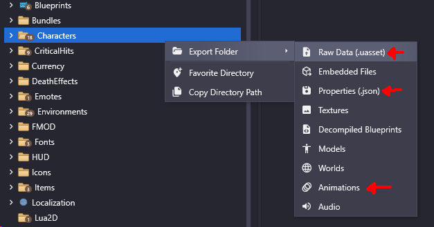

# Rivals 2 hitbox and hurtbox frames

This project reads FModel exports for Rivals 2, builds a per-frame representation of attack and hurt boxes, renders transparent PNGs, and then stitches each move into a GIF (or webm/apng). It can also render a character mesh exported as GLB beneath the boxes.

The expected inputs are:

- FModel property JSON for the attack assets (`ATT_*.json`), the character's body physics asset (`HB_*.json`), and the main skeleton (`Animation/*Skeleton.json`).
- A matching UEFormat animation file (`.ueanim`) for each move animation. Without it, the renderer uses the skeleton reference pose and marks that output as a fallback.
- Optional GLB character meshes under `Skins/Default/`, exported from FModel with **Models → Mesh Format → glTF 2.0**. The overlay option requires this per character.


## 1. Configure FModel and the `.usmap`

1. In FModel, select the Rivals 2 archive directory (the directory containing its `.pak` archive, `Rivals2/Content/Paks/`) and the game's Unreal version. The scripts use `GAME_UE5_8` for CUE4Parse exports and this should be auto-selected by FModel.
2. You can drag the `.usmap` file once the `.pak` is loaded. If that doesn't work open **Settings → General**, enable **Local Mapping File**, and set **Mapping File Path** to the Rivals 2 `.usmap` file. In this workspace the file is named `Rivals2-5.8.0-0+UE5-5418fa4e.usmap`.
3. As of this commit, no AES encryption was present. If that does get implemented, a solution for that needs to be created
4. Reload the archives. Browse to `Rivals2/Content/Characters/` and confirm that packages open and their properties are readable. The mapping file lets CUE4Parse/FModel interpret unversioned package properties; it does not itself extract assets.

FModel settings and package export behavior are described in the [official FModel settings guide](https://github.com/4sval/FModel/wiki/Settings-Explanation) and [Getting Started guide](https://github.com/4sval/FModel/wiki/Getting-Started).

## 2. Export the required data

Export the `Content/Characters` packages while preserving their directory structure. The scripts expect the files to end up beneath this project's `Rivals2/Content/Characters/` directory.

### Properties as JSON

Use FModel's **Save/Export Properties** action (or its **Export Session** in builds that provide it) to export package properties as JSON. At minimum, export:

- Right click on the `Characters` folder and under `Export Folder` select the following:
  - **Properties (.json)**

The renderer reads attack window and hitbox data from the `ATT_*.json`, capsule/sphere hurtbox data from `HB_*.json`, and bone reference transforms from the skeleton JSON. Keep the original package names and folder structure so animation references can be matched.

### Raw assets and animations

Export raw package files and UEFormat animations as separate export types. Raw data supplies `.uasset`/`.uexp` files; the animation export supplies `.ueanim` files. Keep them under the same character folder and preserve FModel's directory structure.

- Right-click the `Characters` folder and under **Export Folder** select:
  - **Raw Data (.uasset)** for the raw package files.
  - **Animations** for the animation files.
- In FModel's settings, set **Models → Mesh Format** to **UEFormat** so the animation export uses UEFormat.

For example:

```text
Rivals2/Content/Characters/Loxodont/
├── Attacks/ATT_Lox_Bair.json
├── HB_Lox.json
└── Animation/
    ├── SK_Lox_Skeleton.json
    └── Attacks/AN_Lox_BAir.ueanim
```

UEFormat model and animation exports use `.uemodel` and `.ueanim`; the frame renderer specifically needs `.ueanim` files for animated poses. Raw `.uasset`/`.uexp` copies do not replace them. See the [UEFormat format and Unreal plugin repository](https://github.com/h4lfheart/UEFormat).

Example:



## 3. Python setup

Create a virtual environment

```bash
python -m venv .venv
```

Activate the virtual environment

### Windows

```powershell
.\.venv\Scripts\activate.ps1
```

### Linux (bash/fish)

```bash
source .venv/bin/activate
```

```bash
source .venv/bin/activate.fish
```

Run commands from the repository directory. Pillow is needed for PNG/GIF rendering:

```bash
python -m pip install -r requirements.txt
```

NumPy is used to skin the GLB mesh vertices against each sampled animation pose.

The renderer can read compressed `.ueanim` files using the `zstandard` Python package or the system `libzstd`. If neither is available, install the Python package:

```bash
python -m pip install zstandard
```

## 4. Render frames

Render all supported characters:

```bash
python rivals2_move_boxes.py --all
```

Render just one character or move:

```bash
python rivals2_move_boxes.py --character Loxodont
python rivals2_move_boxes.py --character Loxodont --move ATT_Lox_Bair
python rivals2_move_boxes.py --character Loxodont --move ATT_Lox_Bair --show-skeleton
python rivals2_move_boxes.py --character Loxodont --move ATT_Lox_Bair --show-character
python rivals2_move_boxes.py --character Loxodont --move ATT_Lox_Bair --skin-textures
```

`--show-character` looks for `Skins/Default/SK_*_Default.glb`, applies the matching `.ueanim` pose, and draws the mesh behind the skeleton and boxes. `--skin-textures` (also accepted as `--skin-texture`) bakes the exported color-region masks, resolves the skin palette through its `CS_*.json` to the referenced `PS_*.json`, and applies each material's exported normal map with basic banded lighting; it implies `--show-character`. This does not reproduce the game's full custom toon shader or outlines. Export the default skeletal mesh to GLB for each character you want to use with these options.

`--camera-rotation DEGREES` rotates the view clockwise around the character. The default, `90`, looks at the gameplay plane (forward/back across the image, up/down vertically), with or without the mesh. Every layer uses the same projection, so mesh, skeleton, hurtboxes, and hitboxes stay aligned. `0` was the old box-only default; it looks along the game's depth axis, so forward-reaching hitboxes appear on top of the character.

The animated skeleton is hidden by default; `--show-skeleton` draws it.

By default, outputs go to `Rivals2/HitboxFrames/<Character>/`. Each attack animation variant gets a folder, such as `ATT_Lox_Bair_Grounded/`. PNGs use a descriptive filename that includes game, character, attack asset, variant, and 1-based frame number:

```text
RoA2_Loxodont_ATT_Lox_Bair_Grounded_HB_0001.png
RoA2_Loxodont_ATT_Lox_Bair_Grounded_HB_0002.png
```

Each move folder also contains:

- `boxes.json` — frame-by-frame box positions and metadata.
- `info.json` and `info.md` — available move stats, active hitbox windows, and the frames where the move changes hurtbox states, to mirror the [Brawl style output](https://rukaidata.com/P+/Ice%20Climbers/subactions/AttackAirF.html)

### Box colors and states


Hitboxes (the attack) are drawn on top of hurtboxes (the character's body). Each box gets a translucent fill and a solid outline. Overlapping boxes stack, so overlaps look more solid.

#### Hitboxes

The color comes from the hitbox's `HitResponse` in `Attacks/ATT_*.json`. For ordinary `Hit` boxes, a "sweet" or "sour" label in the hitbox or damage-property name picks the sweet/sour color.

| Legend | Data value | Meaning |
|---|---|---|
| Hit | `HitResponse: Hit` | A normal damaging hitbox with no sweet/sour label. |
| Sweetspot | `Hit`, name contains `sweet` | The strongest part of a move, usually more damage or knockback. |
| Sourspot | `Hit`, name contains `sour` | The weaker part of a move. |
| Grab | `HitResponse: Grab` | Grabs the opponent instead of hitting: standard grabs, dash/pivot grabs, and command grabs. Ungrabbable hurtboxes ignore it. |
| Hit grab | `HitResponse: HitGrab` | A hit that becomes a grab on contact. Unhitgrabbable hurtboxes ignore it. |
| Detect | `HitResponse: Detect` / `DetectAll` | Checks for contact without dealing damage, e.g. to trigger a follow-up or counter. |
| Kills projectiles | `HitResponse: KillProjectiles` | Only destroys projectiles; does not hit fighters. |

Sweet/sour detection relies on naming, because the game data has no separate sweet/sour field.

#### Hurtboxes

A hurtbox is where the character can be hit. There are three sources:

1. **Body capsules** from the character's physics asset (`HB_*.json`, which `CD_*.json` points to).
2. **`CD_<Character>.json` → `HurtboxDefinitions`.** These either set a body capsule's default state (for example, many characters' elbows and knees are `Ungrabbable` by default) or add extra spheres/capsules for specific moves. Loxodont's `Fspecial Hurtbox` is one; extra hurtboxes stay off until a move turns them on.
3. **`ATT_*.json` → `Windows[].HurtboxStateChanges`.** These change states during a move. A blank or `None` hurtbox name means all hurtboxes. Setting a state to `Default` returns each hurtbox to its own default from step 2.

| Legend | `ERivalsHurtboxState` | Meaning |
|---|---|---|
| Normal (Default / Vulnerable) | `Default`, `Vulnerable` | Normal: can be hit and grabbed. Moves use both names when turning hurtboxes back to normal. |
| Ungrabbable | `Ungrabbable` | Can be hit but not grabbed. Common on limbs by default and on the whole body while holding a grab. |
| Unhitgrabbable | `Unhitgrabbable` | Can be hit, but hit-grabs (Hit grab hitboxes) don't connect. |
| Intangible | `Intangible` | Attacks pass through without touching. Getup and ledge options use this. |
| Projectile intangible | `ProjectileIntangible` | Intangible to projectiles only; melee attacks still connect. |
| Invulnerable | `Invulnerable` | Attacks connect but the character takes no damage or knockback. |
| Countering | `Countering` | Being hit triggers the character's counter. |
| Parrying | `Parrying` | Being hit triggers a parry. |
| Inactive | `Inactive` | Switched to an inactive state by the move (for example while traveling or hidden); treat as not hittable. |
| Disabled | `HurtboxActive: false` | The hurtbox is turned off entirely. Hidden by default; set `HURTBOX_SHOW_DISABLED = True` to draw it. |

The meanings come from the state names and how moves use them. The game files have no descriptions, so treat the states marked * in the legend image (`Invulnerable`, `Countering`, `Parrying`, `Inactive`) as best interpretations. The legend image is drawn by `make_legend.py`: its colors and styling come from `rivals2_move_boxes.py`, and its explanations are the `LEGEND_ENTRIES` list in `make_legend.py`. Keep that list and these tables in step.

The physics asset also has a `CollisionEnabled` flag (`QueryAndPhysics` / `NoCollision`). That is Unreal's physics setting, not a gameplay state: on Loxodont, the left limbs are `QueryAndPhysics` and the right limbs are `NoCollision`. It is saved in `boxes.json` for reference but does not affect colors.

#### Changing colors

All colors and opacities are named settings near the top of `rivals2_move_boxes.py`: `HITBOX_FILL_COLOR_*`, `HURTBOX_FILL_COLOR_*`, `HITBOX_FILL_ALPHA`, `HURTBOX_FILL_ALPHA`, and the outline settings. Colors are `(R, G, B)` tuples. Alpha runs from 0 (invisible) to 255 (solid): 50% is 128, 80% is 204. The GIF converter and `make_legend.py` read the same settings. After changing colors or legend text, regenerate the legend image:

```bash
python make_legend.py                      # writes images/box_legend.png
python make_legend.py --out /tmp/legend.png   # or write it somewhere else
```

To change the output root, pass `--out`. With `--all`, the character name is added below that root:

```bash
python rivals2_move_boxes.py --all --out Rivals2/HitboxFrames
```

## 5. Create GIFs

Create a GIF for every move folder for every character. In fish or bash, run:

```bash
./make_character_gifs.sh --all Rivals2/HitboxFrames Rivals2/GIFs --no-dither
```

**TODO**
  - Create a windows batch script to handle this as well

This creates one subfolder per character and names each GIF after its move folder, for example `Rivals2/GIFs/Loxodont/ATT_Lox_Bair_Grounded.gif`.

To use a matte color instead of `--no-dither`:

```bash
./make_character_gifs.sh --all Rivals2/HitboxFrames Rivals2/GIFs --matte-color 313338
```

`--no-dither` and `--matte-color` are mutually exclusive. To render one move manually:

```bash
python make_attack_gif.py Rivals2/HitboxFrames/Loxodont/ATT_Lox_Bair_Grounded \
  --out Rivals2/GIFs/Loxodont/ATT_Lox_Bair_Grounded.gif --no-dither
```

`make_attack_gif.py` accepts both the newer descriptive `*_HB_####.png` names and legacy `frame_####.png` names. GIF transparency supports only fully transparent or fully opaque pixels; APNG and WebM output can preserve partial alpha. WebM export requires `ffmpeg` installed and available on `PATH`:

```bash
python make_attack_gif.py Rivals2/HitboxFrames/Loxodont/ATT_Lox_Bair_Grounded --format apng
python make_attack_gif.py Rivals2/HitboxFrames/Loxodont/ATT_Lox_Bair_Grounded --format webm
```

## Optional: batch export from the pak (instead of FModel)

> **Not yet tested end to end.** The exporter is written against CUE4Parse's current API, and the `check` command has been run against FModel exports, but the build and a full export have not been run on this project yet. Compare a character's output against FModel before replacing your exports.

`export_characters_from_pak.py` drives a small exporter (`tools/pak_exporter/`) built on [CUE4Parse](https://github.com/FabianFG/CUE4Parse), the library FModel itself uses. One run exports everything the renderer reads for every character, keeping FModel's `Rivals2/Content/Characters/...` layout. It needs `git` and the [.NET 10 SDK](https://dotnet.microsoft.com/download) (`dotnet`), on Windows and Linux alike.

```bash
# One time: fetch CUE4Parse at a pinned commit and build the exporter.
python export_characters_from_pak.py setup

# Dry run: list what each export step would write.
python export_characters_from_pak.py export --list

# Export everything (existing files are kept; add --overwrite to replace them).
python export_characters_from_pak.py export

# Just one character, or just some steps:
python export_characters_from_pak.py export --character Loxodont
python export_characters_from_pak.py export --steps json,anims

# Report which renderer inputs each character has or is missing.
python export_characters_from_pak.py check
```

Only the default skin is exported. Packages under any other `Skins/<Name>/` folder (Hockey, Lovers, Holiday, ...) are skipped by every step, because the renderer only uses `Skins/Default`. Pass `--all-skins` to include them.

The export steps (`--steps`, default all four):

| Step | Exports | Used for |
|---|---|---|
| `json` | Properties of every package under `Characters/`, the same as FModel's "Save Properties" | Attacks (`ATT_`), hurtboxes (`HB_`, `CD_`), skeletons, materials and palettes |
| `anims` | `Animation/**/AN_*` as UEFormat `.ueanim` | Animated poses |
| `meshes` | `Skins/Default/SK_*_Default` as `.glb`, with their materials and textures | `--show-character` / `--skin-textures` |
| `textures` | Every texture in each character folder (all skins, UI art) plus the shared `Shared/` and `DefaultMasks/` folders, as `.png` (curve atlases as `.hdr`) | `--skin-textures` color masks, normal maps, shared eye/mask textures, portraits |

Flags for `export`: `--pak`/`--usmap` override the default file names in the project root. `--game` sets CUE4Parse's engine version (default `GAME_UE5_8`). `--out DIR` writes somewhere other than the project root, which is useful for comparing against FModel. `--aes HEX` supplies a key if the pak is ever encrypted. `--verbose` logs every file.

For `setup`: `--ref COMMIT` builds against a different CUE4Parse commit. By default `setup` also builds CUE4Parse's C++ helpers, which needs `cmake` and a C++ compiler (gcc/clang on Linux, Visual Studio's C++ tools on Windows). Rivals 2 requires them: most of its animations are compressed with the ACL codec, which only the helpers can decode. Without them, those animations fail with `Unsupported compressed data type` (Absa exported 97 of 185, Gouie none). `setup` warns if the helper library didn't build. `--no-natives` skips them, which is fine only for JSON/texture/mesh exports.

Texture export on Linux needs SkiaSharp's Linux native library. The exporter project references `SkiaSharp.NativeAssets.Linux.NoDependencies` for this. Builds from before it was added fail every texture with `The type initializer for 'SkiaSharp.SKImageInfo' threw an exception`, and their meshes have no textures; re-run `setup` to fix them.

On its first run, the exporter downloads two decompression libraries (Oodle and zlib-ng) into `tools/pak_exporter/bin/natives/`, as FModel does. Build output (`tools/vendor/`, `tools/pak_exporter/bin/`) is git-ignored.

The earlier approach used the `cue4parse` Python package. Its Linux installer copies a file into its library folder before creating that folder, so the install fails and Python reports `FileNotFoundException: CUE4Parse`. Version 0.0.9 also imports `DetexHelper`, which current CUE4Parse no longer has. This project no longer uses that package. `pip uninstall cue4parse pythonnet clr_loader` removes it from the venv.

