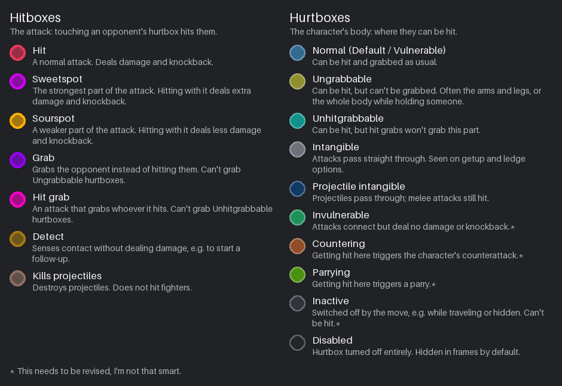

# Rivals 2 hitbox and hurtbox frames

This project reads FModel exports for Rivals 2, builds a per-frame representation of attack and hurt boxes, renders transparent PNGs, and then stitches each move into a GIF (or webm/apng). It can also render a character mesh exported as GLB beneath the boxes.

## **DISCLAIMER**

Yes, I had AI help me work thru a lot of the data aggregation, so I could get this project completed in a week instead of what would likely take me months. I did most of the initial work figuring out a workflow of pak extraction and going through Loxodont (my main) files so I could understand what was needed. If you disagree, you can leave lodge your discontent in issues and I will reply to them.

___

The expected inputs are:

- FModel property JSON for the attack assets (`ATT_*.json`), the character's body physics asset (`HB_*.json`), and the main skeleton (`Animation/*Skeleton.json`).
- A matching UEFormat animation file (`.ueanim`) for each move animation. Without it, the renderer uses the skeleton reference pose and marks that output as a fallback.
- Optional GLB character meshes under `Skins/Default/`, exported from FModel with **Models → Mesh Format → glTF 2.0**. The overlay option requires this per character.



## 1. Configure FModel and the `.usmap`

1. In FModel, select the Rivals 2 archive directory (the directory containing its `.pak` archive, `Rivals2/Content/Paks/`) and the game's Unreal version. The scripts use `GAME_UE5_8` for CUE4Parse exports and this should be auto-selected by FModel.
2. You can drag the `.usmap` file once the `.pak` is loaded. If that doesn't work open **Settings → General**, enable **Local Mapping File**, and set **Mapping File Path** to the Rivals 2 `.usmap` file. In this workspace the file is named `Rivals2-5.8.0-0+UE5-5418fa4e.usmap`.
3. As of this commit, no AES encryption was present. If that does get implemented, a solution for that needs to be created
4. Reload the archives. Browse to `Rivals2/Content/Characters/` and confirm that packages open and their properties are readable. The mapping file lets CUE4Parse/FModel interpret unversioned package properties; it does not itself extract assets.

FModel settings and package export behavior are described in the [official FModel settings guide](https://github.com/4sval/FModel/wiki/Settings-Explanation) and [Getting Started guide](https://github.com/4sval/FModel/wiki/Getting-Started).

## 2. Export the required data

Export the `Content/Characters` packages while preserving their directory structure. The scripts expect the files to end up beneath this project's `Rivals2/Content/Characters/` directory.

### Properties as JSON

Use FModel's **Save/Export Properties** action (or its **Export Session** in builds that provide it) to export package properties as JSON. At minimum, export:

- Right click on the `Characters` folder and under `Export Folder` select the following:
  - **Properties (.json)**

The renderer reads attack window and hitbox data from the `ATT_*.json`, capsule/sphere hurtbox data from `HB_*.json`, and bone reference transforms from the skeleton JSON. Keep the original package names and folder structure so animation references can be matched.

### Raw assets and animations

Export raw package files and UEFormat animations as separate export types. Raw data supplies `.uasset`/`.uexp` files; the animation export supplies `.ueanim` files. Keep them under the same character folder and preserve FModel's directory structure.

- Right-click the `Characters` folder and under **Export Folder** select:
  - **Raw Data (.uasset)** for the raw package files.
  - **Animations** for the animation files.
- In FModel's settings, set **Models → Mesh Format** to **UEFormat** so the animation export uses UEFormat.

For example:

```text
Rivals2/Content/Characters/Loxodont/
├── Attacks/ATT_Lox_Bair.json
├── HB_Lox.json
└── Animation/
    ├── SK_Lox_Skeleton.json
    └── Attacks/AN_Lox_BAir.ueanim
```

UEFormat model and animation exports use `.uemodel` and `.ueanim`; the frame renderer specifically needs `.ueanim` files for animated poses. Raw `.uasset`/`.uexp` copies do not replace them. See the [UEFormat format and Unreal plugin repository](https://github.com/h4lfheart/UEFormat).

Example:


## 3. Python setup

Create a virtual environment

```bash
python -m venv .venv
```

Activate the virtual environment

### Windows

```powershell
.\.venv\Scripts\activate.ps1
```

### Linux (bash/fish)

```bash
source .venv/bin/activate
```

```bash
source .venv/bin/activate.fish
```

Run commands from the repository directory. Pillow is needed for PNG/GIF rendering:

```bash
python -m pip install -r requirements.txt
```

NumPy is used to skin the GLB mesh vertices against each sampled animation pose.

The renderer can read compressed `.ueanim` files using the `zstandard` Python package or the system `libzstd`. If neither is available, install the Python package:

```bash
python -m pip install zstandard
```

## 4. Render frames

Render all supported characters:

```bash
python rivals2_move_boxes.py --all
```

Render just one character or move:

```bash
python rivals2_move_boxes.py --character Loxodont
python rivals2_move_boxes.py --character Loxodont --move ATT_Lox_Bair
python rivals2_move_boxes.py --character Loxodont --move ATT_Lox_Bair --show-skeleton
python rivals2_move_boxes.py --character Loxodont --move ATT_Lox_Bair --show-character
python rivals2_move_boxes.py --character Loxodont --move ATT_Lox_Bair --skin-textures
```

`--show-character` looks for `Skins/Default/SK_*_Default.glb`, applies the matching `.ueanim` pose, and draws the mesh behind the skeleton and boxes. `--skin-textures` (also accepted as `--skin-texture`) bakes the exported color-region masks, resolves the skin palette through its `CS_*.json` to the referenced `PS_*.json`, and applies each material's exported normal map with basic banded lighting; it implies `--show-character`. This does not reproduce the game's full custom toon shader or outlines. Textured rendering takes about 0.15 s per frame (it rasterizes all of the mesh's triangles at once with NumPy). The untextured `--show-character` mesh still draws triangles one at a time with Pillow and is slower. Export the default skeletal mesh to GLB for each character you want to use with these options.

`--camera-rotation DEGREES` rotates the view clockwise around the character. The default, `90`, looks at the gameplay plane (forward/back across the image, up/down vertically), with or without the mesh. Every layer uses the same projection, so mesh, skeleton, hurtboxes, and hitboxes stay aligned. `0` was the old box-only default; it looks along the game's depth axis, so forward-reaching hitboxes appear on top of the character.

The animated skeleton is hidden by default; `--show-skeleton` draws it.

By default, outputs go to `Rivals2/HitboxFrames/<Character>/`. Each attack animation variant gets a folder, such as `ATT_Lox_Bair_Grounded/`. PNGs use a descriptive filename that includes game, character, attack asset, variant, and frame number. The first frame of the move is `0000`:

```text
RoA2_Loxodont_ATT_Lox_Bair_Grounded_HB_0000.png
RoA2_Loxodont_ATT_Lox_Bair_Grounded_HB_0001.png
```

`info.md` frame numbers (hit frame, active frames) still use the usual 1-based frame-data convention, so PNG `_HB_0006` is frame 7 there. For example, Clairen Dtilt is "active 7-8" in `info.md`, and the hitboxes appear on `_HB_0006` and `_HB_0007`.

Each move folder also contains:

- `boxes.json` — frame-by-frame box positions and metadata.
- `active_frames.txt` — the PNGs with an active hitbox, one per line with the hitbox names (`<file>` tab `<hitboxes>`), to pick out the frames that matter. Article sensor boxes (`Detect`, e.g. Absa's cloud "Static Detector", which is on as long as the cloud exists) don't count; the character's own Detect boxes (counters) do. The same list is in `info.json` under `active_frames`.
- `info.json` and `info.md` — available move stats, active hitbox windows, a **Hitboxes** table (frames, type, sweet/sour, damage, base knockback, knockback scaling, angle, on-hit effect, radius, and a Notes column with any non-default settings such as hitstun/hitpause multipliers, shield stun, forced tumble, no reverse hit or ignores weight), the same table per article, and the frames where the move changes hurtbox states, to mirror the [Brawl style output](https://rukaidata.com/P+/Ice%20Climbers/subactions/AttackAirF.html)

### Box colors and states


Hitboxes (the attack) are drawn on top of hurtboxes (the character's body). Each box gets a translucent fill and a solid outline. Overlapping boxes stack, so overlaps look more solid.

#### Hitbox shapes

A hitbox's `InitialInterpolationMode` only sets its shape on its first active frame: `None` is a circle, and `Auto`, `Manual` and `ManualPermanent` are capsules. On every later active frame, the game stretches the hitbox from where it was on the previous frame to where it is now, so a moving hitbox is a capsule and a still one a circle. `ManualPermanent` hitboxes instead keep their own capsule on every frame. Galvan Dspecial's claws show this: a circle on their first active frame, capsules while they rise, circles once they stop.

#### Articles

Some moves spawn objects with their own hitboxes, called articles: Galvan Dspecial's claws, Absa's cloud, Zetterburn's fireball, Fleet's arrows and so on. They're drawn from the game data. Each one starts where and when the move spawns it, runs its own windows, velocity and gravity, and its hitboxes ride on its own animated skeleton. With `--show-character`/`--skin-textures`, the article's mesh (e.g. Galvan's claw chain) is drawn too. `info.md` lists them under "Articles", with each hitbox's active frames.

The move itself is always rendered in full. Past its end, frames continue only until each article's hitboxes have appeared or last changed, at most 10 more (`ARTICLE_EXTRA_FRAMES`), with the character holding its last pose. A projectile that only travels adds nothing new frame to frame, so it isn't followed further. `info.md` still gives each article hitbox's full frame range from the simulation, e.g. `Uncharged (Hit) 50-52`; "(continues)" means it was still active where the simulation stopped.

Some article behavior is decided by game code, not data: Absa's cloud is placed when special is released, and Nspecial pops a cloud that's already out. Projectiles also don't home, bounce or collide here. For moves that need it, `article_rules.json` holds small hand-written rules, added as you find moves that need them:

- `"switch"`: when the move enters a window, the article jumps to another window. For example, Absa Fspecial entering Recovery (the release) sends the cloud to "Place Startup".
- `"existing"`: the move drives an article that is already out, at an assumed position. For example, Absa NspecialCloud charges or pops a cloud assumed to be 300 ahead and 100 up.

Each rule's `note` is printed in `info.md`, so the wiki shows which frames rest on an assumption. The file's `_about` entry explains the format.

#### Hitboxes

The color comes from the hitbox's `HitResponse` in `Attacks/ATT_*.json`. For ordinary `Hit` boxes, a tipper effect on the damage properties picks the tipper color; otherwise a "sweet" or "sour" label in the hitbox or damage-property name picks the sweet/sour color.

| Legend | Data value | Meaning |
|---|---|---|
| Hit | `HitResponse: Hit` | A normal damaging hitbox with no sweet/sour label. |
| Sweetspot | `Hit`, name contains `sweet` | The strongest part of a move, usually more damage or knockback. |
| Sourspot | `Hit`, name contains `sour` | The weaker part of a move. |
| Projectile | `Hit` from an article with `bIsProjectile` (fireballs, arrows, Absa's cloud, ...) | A projectile's hit. Training mode shows these yellow, whatever their names say, so they take this color ahead of tipper and sweet/sour. Sensors (`Detect`) on projectiles keep the Detect color. |
| Tipper | `Hit`, damage properties have `SpecialEffect: TipperStun` (or `AutoTipperOnly` on throws) | Clairen's sword-tip hit, which stuns. Training mode's hitbox view shows these light blue and every other hit red. |
| Grab | `HitResponse: Grab` | Grabs the opponent instead of hitting: standard grabs, dash/pivot grabs, and command grabs. Ungrabbable hurtboxes ignore it. |
| Hit grab | `HitResponse: HitGrab` | A hit that becomes a grab on contact. Unhitgrabbable hurtboxes ignore it. |
| Detect | `HitResponse: Detect` / `DetectAll` | Checks for contact without dealing damage, e.g. to trigger a follow-up or counter. |
| Kills projectiles | `HitResponse: KillProjectiles` | Only destroys projectiles; does not hit fighters. |

Sweet/sour detection relies on naming, because the game data has no separate sweet/sour field, and training mode doesn't show it: there, sour and normal hits are both red. In the 94 same-phase sweet/sour pairs in the game, the sweet hit is stronger in 91; the exceptions (Lox Ftilt pull, Orcane Ustrong puddle, Absa Ftilt) aren't true pairs or have equal numbers. Tippers come from data (`SpecialEffect`), not names: many hitboxes named "Tip" are just the tip of a limb or weapon, and Wrastor's Fair "Tipper" has no effect and stays a normal hit. Other on-hit effects (Burn, Zap, Poison, ...) are not drawn.

#### Hurtboxes

A hurtbox is where the character can be hit. There are three sources:

1. **Body capsules** from the character's physics asset (`HB_*.json`, which `CD_*.json` points to).
2. **`CD_<Character>.json` → `HurtboxDefinitions`.** These either set a body capsule's default state (for example, many characters' elbows and knees are `Ungrabbable` by default) or add extra spheres/capsules for specific moves. Loxodont's `Fspecial Hurtbox` is one; extra hurtboxes stay off until a move turns them on.
3. **`ATT_*.json` → `Windows[].HurtboxStateChanges`.** These change states during a move. A blank or `None` hurtbox name means all hurtboxes. Setting a state to `Default` returns each hurtbox to its own default from step 2.

| Legend | `ERivalsHurtboxState` | Meaning |
|---|---|---|
| Normal (Default / Vulnerable) | `Default`, `Vulnerable` | Normal: can be hit and grabbed. Moves use both names when turning hurtboxes back to normal. |
| Ungrabbable | `Ungrabbable` | Can be hit but not grabbed. Common on limbs by default and on the whole body while holding a grab. |
| Unhitgrabbable | `Unhitgrabbable` | Can be hit, but hit-grabs (Hit grab hitboxes) don't connect. |
| Intangible | `Intangible` | Attacks pass through without touching. Getup and ledge options use this. |
| Projectile intangible | `ProjectileIntangible` | Intangible to projectiles only; melee attacks still connect. |
| Invulnerable | `Invulnerable` | Attacks connect but the character takes no damage or knockback. |
| Countering | `Countering` | Being hit triggers the character's counter. |
| Parrying | `Parrying` | Being hit triggers a parry. |
| Inactive | `Inactive` | Switched to an inactive state by the move (for example while traveling or hidden); treat as not hittable. |
| Disabled | `HurtboxActive: false` | The hurtbox is turned off entirely. Hidden by default; set `HURTBOX_SHOW_DISABLED = True` to draw it. |

The meanings come from the state names and how moves use them. The game files have no descriptions, so treat the states marked * in the legend image (`Invulnerable`, `Countering`, `Parrying`, `Inactive`) as best interpretations. The legend image is drawn by `make_legend.py`: its colors and styling come from `rivals2_move_boxes.py`, and its explanations are the `LEGEND_ENTRIES` list in `make_legend.py`. Keep that list and these tables in step.

The physics asset also has a `CollisionEnabled` flag (`QueryAndPhysics` / `NoCollision`). That is Unreal's physics setting, not a gameplay state: on Loxodont, the left limbs are `QueryAndPhysics` and the right limbs are `NoCollision`. It is saved in `boxes.json` for reference but does not affect colors.

#### Settings files

Two JSON files in the project root hold everything meant to be edited by hand. The scripts read them on every run, so no code changes are needed:

- **`render_settings.json`**:
  - box colors, opacities and outline widths (`hitbox`, `hurtbox`, `skeleton`);
  - which on-hit effects count as tipper (`tipper_effects`);
  - how many frames past a move articles may extend it (`articles.extra_frames`);
  - which settings info.md's Notes column treats as usual and leaves out (`info_notes_defaults`);
  - the moves `run_pipeline.py` skips by default (`pipeline.default_skips`).

  Colors are `[R, G, B]` (0-255) or `"#RRGGBB"`. Alpha runs from 0 (invisible) to 255 (solid): 50% is 128, 80% is 204. Anything you delete falls back to the scripts' built-in values. Keys starting with `_` are notes.
- **`article_rules.json`**: per-move rules for article behavior that lives in game code (see [Articles](#articles)).

Both files are excepted from the repo's `*.json` ignore rule, so git tracks them. The GIF converter and `make_legend.py` use the same colors. After changing colors or legend text, regenerate the legend image:

```bash
python make_legend.py                      # writes images/box_legend.png
python make_legend.py --out /tmp/legend.png   # or write it somewhere else
```

To change the output root, pass `--out`. With `--all`, the character name is added below that root:

```bash
python rivals2_move_boxes.py --all --out Rivals2/HitboxFrames
```

## 5. Create GIFs

Create a GIF for every move folder for every character. In fish or bash, run:

```bash
./make_character_gifs.sh --all Rivals2/HitboxFrames Rivals2/GIFs --no-dither
```

**TODO**
  - Create a windows batch script to handle this as well

This creates one subfolder per character and names each GIF after its move folder, for example `Rivals2/GIFs/Loxodont/ATT_Lox_Bair_Grounded.gif`.

To use a matte color instead of `--no-dither`:

```bash
./make_character_gifs.sh --all Rivals2/HitboxFrames Rivals2/GIFs --matte-color 313338
```

`--no-dither` and `--matte-color` are mutually exclusive. To render one move manually:

```bash
python make_attack_gif.py Rivals2/HitboxFrames/Loxodont/ATT_Lox_Bair_Grounded \
  --out Rivals2/GIFs/Loxodont/ATT_Lox_Bair_Grounded.gif --no-dither
```

`make_attack_gif.py` accepts both the newer descriptive `*_HB_####.png` names and legacy `frame_####.png` names. GIF transparency supports only fully transparent or fully opaque pixels; APNG and WebM output can preserve partial alpha. WebM export requires `ffmpeg` installed and available on `PATH`:

```bash
python make_attack_gif.py Rivals2/HitboxFrames/Loxodont/ATT_Lox_Bair_Grounded --format apng
python make_attack_gif.py Rivals2/HitboxFrames/Loxodont/ATT_Lox_Bair_Grounded --format webm
```

## Full pipeline: new pak to frames, with a timed report

`run_pipeline.py` runs every step after a game update, from exporting the pak to rendering every character, and records how long each step took. It's plain Python, so it works the same from fish, bash or Windows, and it always runs the project scripts with the `.venv` interpreter.

```bash
python run_pipeline.py                                   # export + check + render, all characters
python run_pipeline.py --game-dir "/mnt/games/SteamLibrary/steamapps/common/Rivals 2"   # game not in a Steam library it can find
python run_pipeline.py --jobs 4                          # render 4 characters at once
python run_pipeline.py --character Loxodont --character Absa
python run_pipeline.py --steps render --clean            # re-render only, into fresh folders
python run_pipeline.py --gifs --gif-args=--no-dither     # also make GIFs
python run_pipeline.py --no-skin-textures --jobs 6       # boxes only: a quick check after a patch
```

In a terminal, the pipeline shows one block that's redrawn in place instead of scrolling. It lists every step as done, running or waiting, with its time. The running step has a bar with percent, ETA and counts (characters, moves, frames). Below it is one bar per character, or per export kind, being worked on right now, with the move it just finished:

```
Rivals 2 pipeline · 14.5s · step 2 of 3: render
 ✓ 1/3 check   ok           0.0s  1 character, all inputs present
 ▶ 2/3 render     14.5s  [░░░░░░░░░░░░░░░░░░░░░░░░]   3%  ETA 8m12s  0/1 characters · 1/35 moves · 50 frames
     Loxodont    [░░░░░░░░░░░░░░]    1/35   moves     14.5s  ATT_Lox_Bair_Aerial (50 frames)
 · 3/3 gifs
```

When the output goes to a file or a pipe, or with `--no-progress`, it prints plain lines instead. Ctrl+C stops the running renders, marks that step `interrupted`, and still writes the report.

The steps, in order (`--steps` picks a comma list; the default is `export,check,render`):

| Step | What it runs |
|---|---|
| `setup` | `export_characters_from_pak.py setup`. Added automatically if the exporter isn't built yet, or if `tools/pak_exporter/Program.cs` or its `.csproj` changed since the last build. List it yourself to force a rebuild. |
| `export` | `export_characters_from_pak.py export` once per kind (`json`, `anims`, `meshes`, `textures`), so each one is timed separately. Existing files are **replaced**, because the point is to pick up the update. `--keep-existing` only fills in missing files. |
| `check` | `export_characters_from_pak.py check`, the per-character input report |
| `render` | `rivals2_move_boxes.py --character <C> --skin-textures` for each character with attacks and a skeleton. The textured default skin is drawn under the boxes; `--no-skin-textures` renders boxes only. |
| `gifs` | `make_attack_gif.py` for every rendered move folder (add with `--gifs` or `--steps ...,gifs`) |

If `setup` or `export` fails outright, the pipeline stops, because later steps would use stale inputs. A per-file export failure (exporter exit code 3) is reported as `partial`, and the run continues.

Flags:

- `--game-dir DIR`: the Rivals 2 install folder, for installs Steam doesn't know about. By default the game is found through Steam (see [Where the pak is read from](#where-the-pak-is-read-from)), so after a Steam update you just re-run the pipeline. `--pak FILE` picks one specific pak instead.
- `--usmap FILE`: the mappings file (default: the one in the project root). A game update that changes Unreal classes needs a new `.usmap`. The report's Steam build number tells you which update a run used.
- `--character NAME`: limit every step to that character (repeatable; default all).
- `--jobs N`: render or animate N characters in parallel (default 1). Each job is one Python process using one CPU core and about 400 MB of memory with skin textures. Use up to one less than your core count, e.g. `--jobs 7` on 8 cores. Timings for all of Loxodont (34 moves, 3424 frames, default skips) on an 8-core Linux machine, one job:
  - Textured (the default): 8m12s, about 7 frames per second. The roster is about 67,000 frames after the default skips, so about 2h40m on one job, or roughly half an hour with `--jobs 7` (an estimate; a parallel run hasn't been timed).
  - Boxes only (`--no-skin-textures`): 1m18s, about 44 frames per second, so about 25 minutes for the roster on one job.
- Skipped moves: by default the render step skips intros, taunts and leftover `*_OLD` attack assets: 39 of the roster's 746 move variants, about 6% of the frames, almost all of it intros. The patterns are case-insensitive regular expressions matched against the attack asset name (`ATT_Lox_Intro`). `--skip REGEX` skips more (repeatable, e.g. `--skip Pummel`); `--no-default-skips` renders everything. The renderer takes the same `--skip` option directly. With `--clean`, folders of skipped moves from earlier runs are removed too.
- `--skin-textures` / `--no-skin-textures`: draw the textured default skin under the boxes (default on). `--show-character` with `--no-skin-textures` draws the untextured mesh. Characters without an exported default mesh fall back to boxes only.
- `--clean`: delete each character's old `Rivals2/HitboxFrames/<Character>` folder before rendering it. Without it, folders for moves a patch removed stay behind (frames inside a re-rendered move are always replaced).
- `--frames-out DIR`, `--gifs-out DIR`: output roots (default `Rivals2/HitboxFrames`, `Rivals2/GIFs`).
- `--show-skeleton`, `--camera-rotation`: passed to `rivals2_move_boxes.py`.
- `--gif-args=...`: extra `make_attack_gif.py` options as one string. Use the `=`, or the value is read as an option: `--gif-args=--no-dither`, `--gif-args='--format webm'`.
- `--all-skins`: passed to the exporter.
- `--report-dir DIR`: where the report goes. `--no-progress`: plain lines instead of the live display. `--verbose`: echo the exporter's output (implies `--no-progress`).

Each run writes `Rivals2/PipelineReports/<date_time>/`:

- `report.md`: total and per-step times; per export kind, files written, skipped and failed; the `check` table; per character, render time, moves, frames, frames per second and missing animations; the 15 slowest moves; per-character animation counts.
- `report.json`: the same data, for scripts or comparing runs.
- `logs/`: full output of every step and every character (`render_Loxodont.log`, `export_anims.log`, ...). The logs are line-buffered, so `tail -f` works during a run.

The report is rewritten after every step, so a run that dies or is stopped with Ctrl+C still leaves the finished steps' numbers. With `--jobs` above 1, character times overlap: they're wall-clock per character, and the step time is the real total.

## Optional: batch export from the pak (instead of FModel)

> **Tested 2026-11-26** on the Steam install (build 26791686): JSON, default meshes and textures for every character. Animations were checked on Absa after the ACL fix described below: all 185 exported, all 37 the attacks need parse in the renderer, and the poses are sane. Comparing a full export file by file against FModel's hasn't been done.

`export_characters_from_pak.py` drives a small exporter (`tools/pak_exporter/`) built on [CUE4Parse](https://github.com/FabianFG/CUE4Parse), the library FModel itself uses. One run exports everything the renderer reads for every character, keeping FModel's `Rivals2/Content/Characters/...` layout. It needs `git` and the [.NET 10 SDK](https://dotnet.microsoft.com/download) (`dotnet`), on Windows and Linux alike.

```bash
# One time: fetch CUE4Parse at a pinned commit and build the exporter.
python export_characters_from_pak.py setup

# Dry run: list what each export step would write.
python export_characters_from_pak.py export --list

# Export everything (existing files are kept; add --overwrite to replace them).
python export_characters_from_pak.py export

# Just one character, or just some steps:
python export_characters_from_pak.py export --character Loxodont
python export_characters_from_pak.py export --steps json,anims

# Report which renderer inputs each character has or is missing.
python export_characters_from_pak.py check
```

### Where the pak is read from

The exporter reads the pak straight from the game install, so it runs against the folder Steam updates. It uses the first of these that applies:

1. `--pak FILE`: one specific `.pak`. Every archive in the same folder is mounted with it.
2. `--game-dir DIR`: the install folder (`.../steamapps/common/Rivals 2`) or its `Rivals2/Content/Paks` folder.
3. The `RIVALS2_GAME_DIR` environment variable, same meaning as `--game-dir`. This is handy if the game lives somewhere Steam doesn't track. In fish: `set -Ux RIVALS2_GAME_DIR "/path/to/Rivals 2"`. In bash: `export RIVALS2_GAME_DIR=...`.
4. Steam: Rivals 2 (app 2217000) in any Steam library. Libraries come from Steam's `libraryfolders.vdf`, so games on other drives are found too. The Steam folders checked are:
   - Windows: the registry and `Program Files (x86)\Steam`;
   - Linux: `~/.local/share/Steam`, `~/.steam/steam`, Flatpak (`~/.var/app/com.valvesoftware.Steam/...`) and Snap.
5. `Rivals2-Windows.pak` copied into the project root.

`python export_characters_from_pak.py find-game` prints which pak it would use, how it found it, and the Steam build id, which changes with every game update.

Only the default skin is exported. Packages under any other `Skins/<Name>/` folder (Hockey, Lovers, Holiday, ...) are skipped by every step, because the renderer only uses `Skins/Default`. Pass `--all-skins` to include them.

The export steps (`--steps`, default all four):

| Step | Exports | Used for |
|---|---|---|
| `json` | Properties of every package under `Characters/`, the same as FModel's "Save Properties" | Attacks (`ATT_`), hurtboxes (`HB_`, `CD_`), skeletons, materials and palettes |
| `anims` | Every `AN_*` animation as UEFormat `.ueanim`: the character's (`Animation/`) and its articles' (e.g. `Skins/Default/ChainHand/`) | Animated poses |
| `meshes` | Every default-skin skeletal mesh (`Skins/Default/**/SK_*`): the character's `SK_*_Default` and article meshes such as Galvan's claw chain, as `.glb` with materials and textures | `--show-character` / `--skin-textures` |
| `textures` | Every texture in each character folder (all skins, UI art) plus the shared `Shared/` and `DefaultMasks/` folders, as `.png` (curve atlases as `.hdr`) | `--skin-textures` color masks, normal maps, shared eye/mask textures, portraits |

Flags for `export`: `--game-dir`/`--pak` choose the game files (see below); `--usmap` overrides the mappings file in the project root. `--game` sets CUE4Parse's engine version (default `GAME_UE5_8`). `--out DIR` writes somewhere other than the project root, which is useful for comparing against FModel. `--aes HEX` supplies a key if the pak is ever encrypted. `--verbose` logs every file.

For `setup`: `--ref COMMIT` builds against a different CUE4Parse commit. By default `setup` also builds CUE4Parse's C++ helpers, which needs `cmake` and a C++ compiler (gcc/clang on Linux, Visual Studio's C++ tools on Windows). Rivals 2 requires them: many of its animations are compressed with the ACL codec, which only the helpers can decode. `setup` warns if the helper library didn't build. `--no-natives` skips them, which is fine only for JSON/texture/mesh exports. ACL animations also need the plugin mount point `/ACLPlugin/` resolved, because their `BoneCompressionSettings` is `/ACLPlugin/ACLAnimBoneCompressionSettings`. The exporter maps plugin mount points after mounting, as FModel does (`export --verbose` lists them). Builds from before that fix fail those animations with `Unsupported compressed data type` even with the helpers present: Absa had 4 of 37 attack animations, and Galvan, Gouie, La Reina and Slade were mostly missing. With the fix, Absa exports 185 of 185. Re-run `setup` to get it.

Texture export on Linux needs SkiaSharp's Linux native library. The exporter project references `SkiaSharp.NativeAssets.Linux.NoDependencies` for this. Builds from before it was added fail every texture with `The type initializer for 'SkiaSharp.SKImageInfo' threw an exception`, and their meshes have no textures; re-run `setup` to fix them.

On its first run, the exporter downloads two decompression libraries (Oodle and zlib-ng) into `tools/pak_exporter/bin/natives/`, as FModel does. Build output (`tools/vendor/`, `tools/pak_exporter/bin/`) is git-ignored.

The earlier approach used the `cue4parse` Python package. Its Linux installer copies a file into its library folder before creating that folder, so the install fails and Python reports `FileNotFoundException: CUE4Parse`. Version 0.0.9 also imports `DetexHelper`, which current CUE4Parse no longer has. This project no longer uses that package. `pip uninstall cue4parse pythonnet clr_loader` removes it from the venv.

